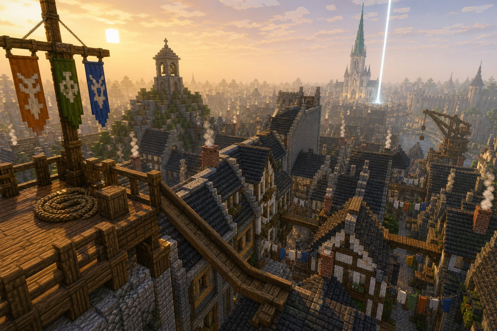
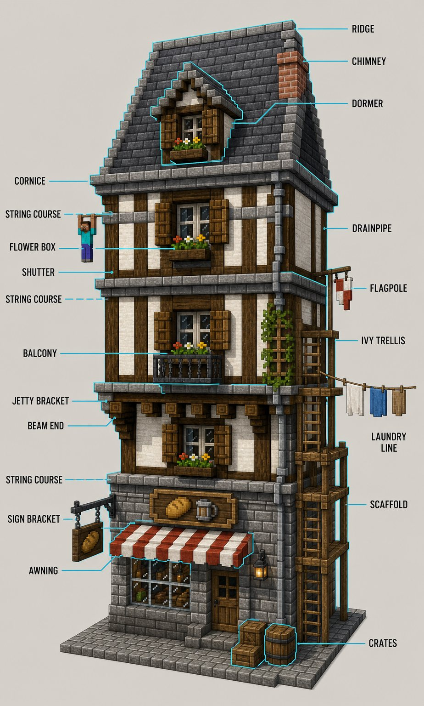

# Carillon M4 · Phase A: what you're approving

After play 1 you said the city is flat, not alive, the run looks placed, and the story doesn't add up. This package is
the plan to fix all four, for your yes before any code changes.

| File | What it is |
|---|---|
| `look-bible.md` | The look: the climbing grid, the movement-tuned dimensions, seven districts, the height plan, street life, the kit, how the generator changes, how the opening's routes come from the city, the twelve landmarks |
| `story.md` | One page of story, and every line from the opening card to "THE CITY IS YOURS." |
| `onboarding.md` | Your addition: just-in-time move tips (one system), the Registry as a walk with an officer, the pan to the city gate, first-stretch tips |
| `concept/` | Nine concept images (below) |
| `facade-grid.svg` | The climbing grid, drawn to the block |

## The idea in one line
**The city is the course, and it is climbable because of its architecture.** Every ledge, box, pipe, awning and line is a
real building element, placed by rules tuned to the Runner's numbers, so every street offers a way up and every roof a
way on, and the opening's route is just the line the director shows you through it.

## What you're saying yes to
1. **The climbing grid:** on every facade, a projecting lip every 2 blocks from 3 up (awnings and hoods, the shop
   cornice, window boxes, floor courses, the eave), matching the catch (1.2–2.4) and the ledge jump (2.5). Courses line up
   along whole streets for shimmying. Clear walls (party walls, warehouses, quays) are for wall-runs. Fences mean no.
2. **A city tuned to the moves:** street widths for jumpable roof gaps (1–3), roofs that chain (one storey at a time),
   a soft way down from everything tall (awnings that bounce, hay carts, water), a crossing over every avenue.
3. **Depth and height:** Bellwatch on a knoll, Choir Square as a stepped bowl with a running arcade round it, the High
   Terrace raised from 8 to 12, garden terraces, towers that read from far away.
4. **Alive:** stalls with real wares, carts, benches, wells, laundry, lamps at every junction, lit windows at night,
   smoke; 400–480 citizens who gather at the market by day and the taverns by night.
5. **The kit:** about 35 blocks of our own (awnings, flower boxes, drainpipes, ropes, lines, signs, slate and clay tiles,
   lit windows, wares).
6. **The run's 414 placed blocks go to nearly zero:** the route comes from the city's own affordances; missing links
   become real buildings (a walkway, a scaffold, a bridge of houses), never stage furniture.
7. **The twelve landmarks** (bible §11), each with its "wow".
8. **The story:** you're a Runner; the Choir's bell rings for you; its gate kills you; you keep thinking. The Void's line
   stays; the infirmary now says the gate put you back on the stones, and "most people stay that way". New voices:
   Kestrel at the Roost, Bram at the Association.
9. **Onboarding:** tips with your real keys, once, then quiet (this reverses "found, not told"); Bram walks you to the
   assessment, fits your band, opens the K menu with you, shows the map, and the camera pans to the High Gate.

Smaller calls inside it: no jetties on the Quay; market spokes 6 → 5 wide; vanilla banners, signs and barrels stay out of
the city's fabric (they're block entities); light at night is mostly emissive (the light-source budget).

## Phase B, in order (biggest visual lift first)
| Step | What | Lifts |
|---|---|---|
| B1 | The facade grammar and the core kit: the grid on all 779 buildings, window vocabulary per district, ridge caps, dormers, chimney tops, crow-stepped gables, Bellwatch's roof mix | every street at once |
| B2 | Relief and heights: the Knoll, the bowl, the Terrace at 12, stepped lanes, roof chaining, crossings over avenues, running faces kept clear (plan regenerated and re-pinned) | flatness |
| B3 | Street life: props, worn paving, lamps, lit windows, smoke, laundry and lines, wares; the roster to 400–480 | alive |
| B4 | The twelve landmarks | the wow |
| B5 | The opening from affordances: the full Runner in the planner, desire gaps fixed in the plan, stage to ~0, routes and golden runs re-recorded | the run |
| B6 | Story and onboarding: the tip system, the wake lines, the Registry walk, the pan, first-stretch tips, STORY.md and SPEC edits | clarity |
| B7 | The quiet perf pass (SPEC §16.10), the tour, your play 3 | |

B6 touches other modules (signal, opening, story) than B1–B5 (city): it could run beside them in its own worktree if you'd
allow two builders at once for this milestone; otherwise it follows B5.

## The concept images
| | |
|---|---|
|  01 · the opening's first view at dawn |  02 · from the Roost: the run ahead, the light in the square |
|  03 · Bellwatch: a stepped lane to the Knoll |  04 · Lantern Quay: gables, hoists, the crane, a wall-run |
|  05 · a Market street: awnings, brackets, bunting |  06 · Choir Square at noon |
|  07 · the High Terrace's climbable wall |  08 · the affordance sheet |
|  09 · the old town at night | |

The images are mood and language, not plans: where they differ from the bible (the river's course, a twin-towered
cathedral instead of the Choir's one spire, a taller Terrace wall), the bible wins.
