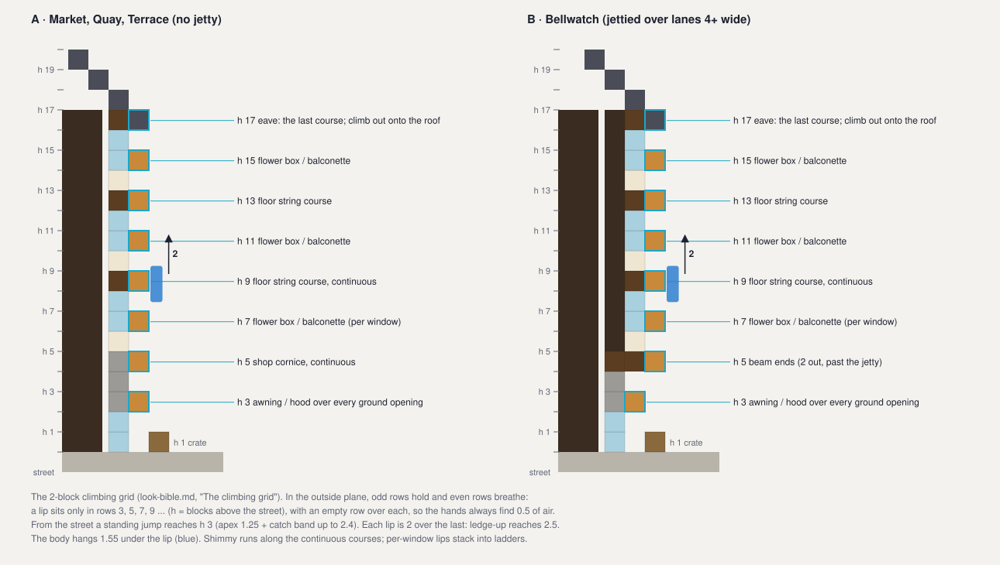
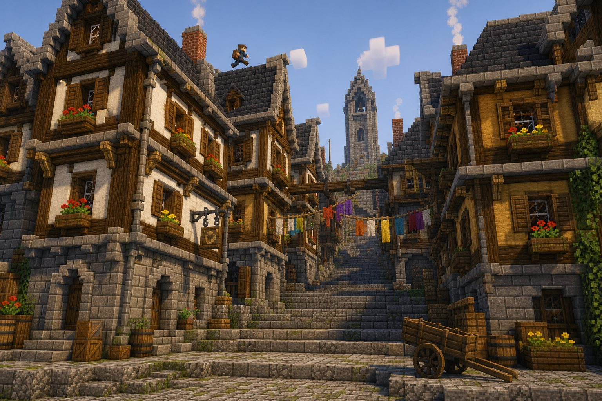
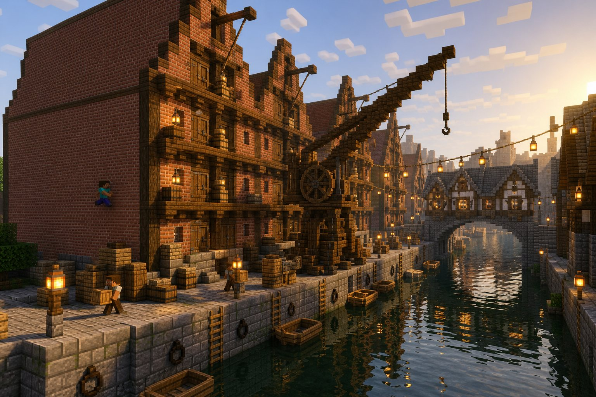
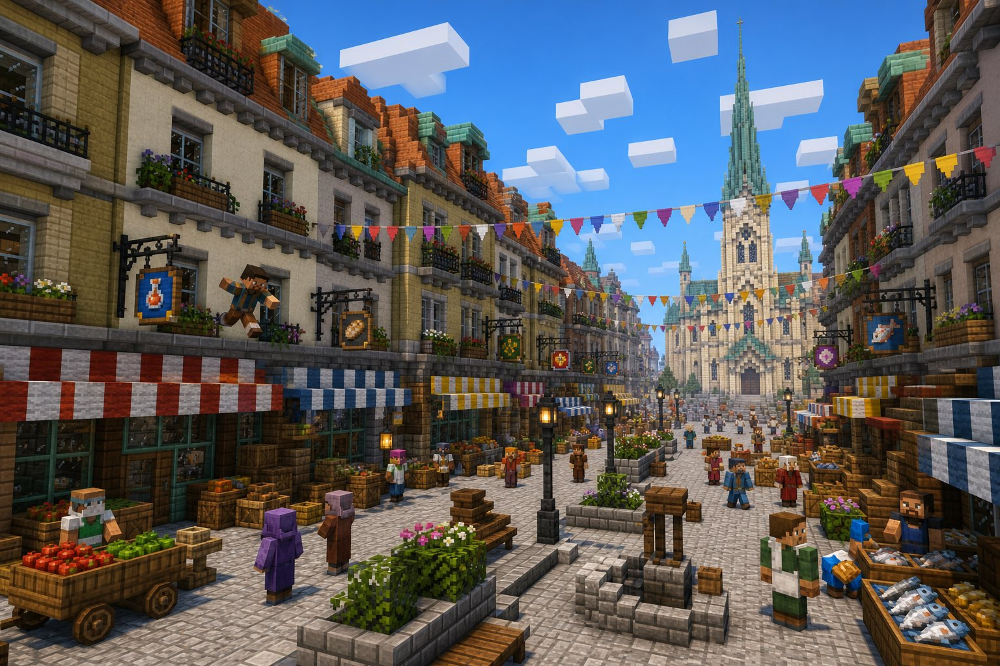
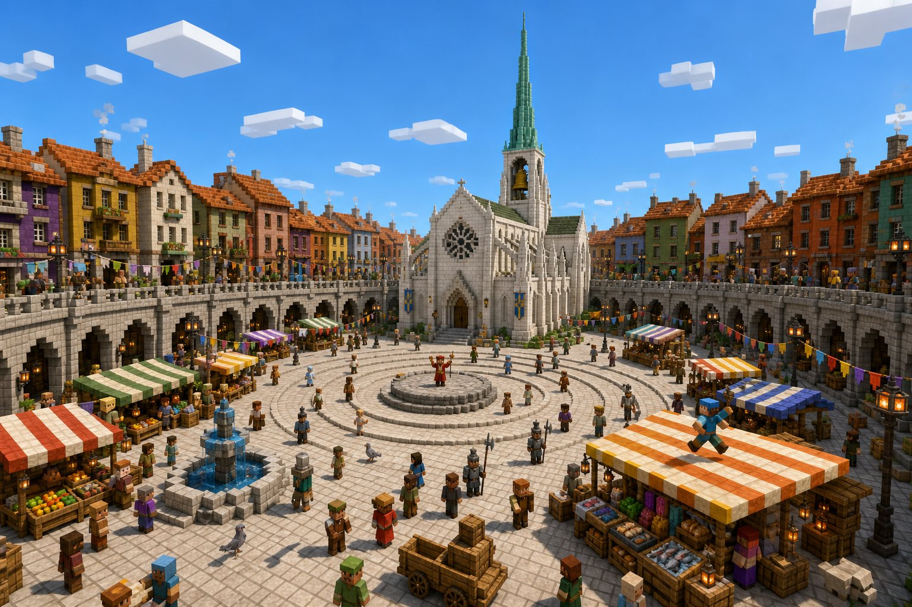
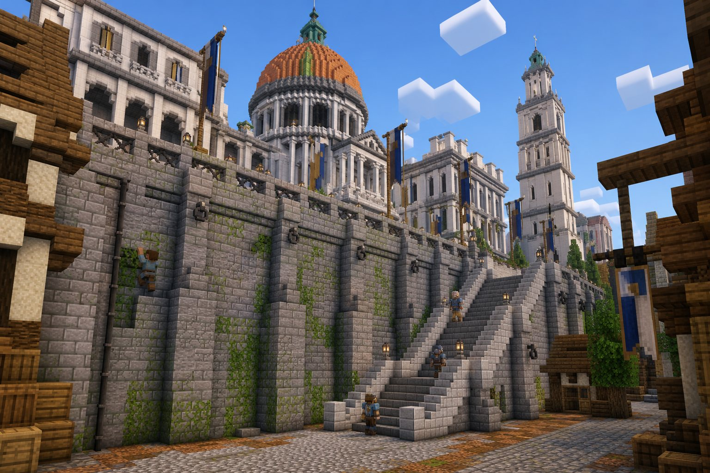
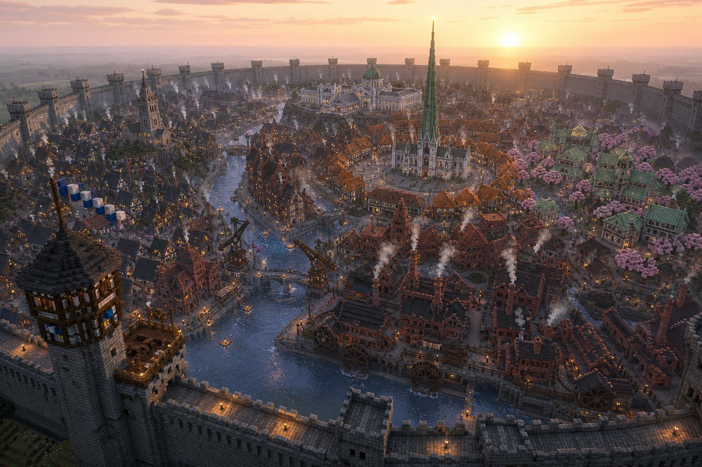
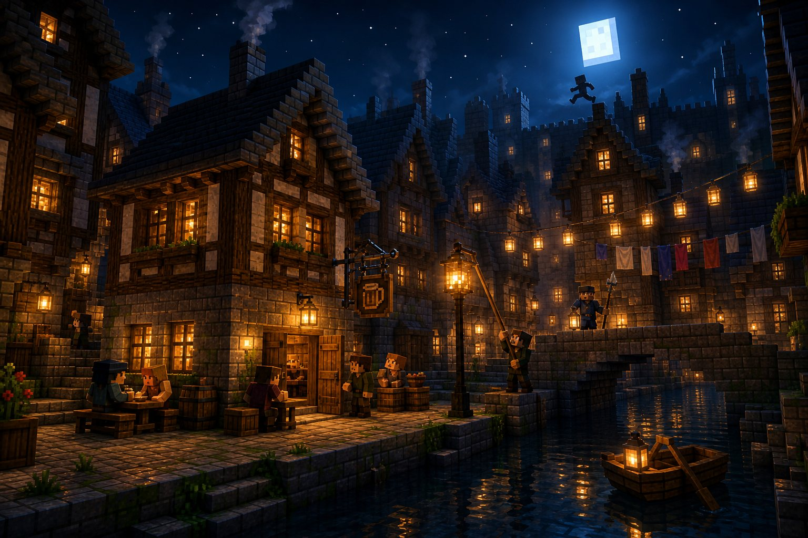

# Carillon M4 · The look bible

Phase A of Milestone 4 (Detail), for Euan's approval before any code changes. Art and narrative direction for the walled
city; the story and the onboarding are in `story.md` and `onboarding.md`, the summary and build order in `README.md`.
Concept art: `concept/` (nine images). The climbing grid as a drawing: `facade-grid.svg`.

Every block id below was checked against the 26.3 assets (`/Volumes/MEDIA/Awaken/.ref/assets`); every movement number
comes from the code (`body/RunnerRules.java`, `body/BodyRules.java`) or SPEC §16.3 and §17.2–17.3.

## 0. What Euan saw, and what it means

Play 1, in his words: "a bit boring", "areas that just don't look very well developed", "not as alive as I want it to
feel", "everything is a bit flat", "the starting run just looks a bit too intentionally placed [...] why would a city just
have random wooden blocks in the middle of the sky?", and "I more so want it so that the city is intuitively something
that you can climb and jump and hang from and wall ride and everything."

What the shots show (docs/carillon/milestones/m1, m2, m3):

| Today | Why it reads flat | Fixed by |
|---|---|---|
| One facade plane; one window (a pane at every third block) in a grid on every storey of every house (m1_market, m1_square, m2_act2_a) | Nothing casts a shadow. No depth, no rhythm, nothing to hold. | §3.1 the climbing grid: a projecting lip every 2 blocks; §5 a window vocabulary per district |
| The street is a flat sheet; the square is a flat disc with a checkerboard (m3_noon_square) | No level changes, no steps, nothing to sit on | §6 relief: the Knoll, the square's bowl, stepped lanes, a higher Terrace |
| Bellwatch is a dark slate mass from the sky (m1_sky_nw, m2_sky_a_top) | One roof tone, one wall tone | §5.1 roof mix, pale ridges, warm chimneys, coloured gables, laundry |
| The run's 414 stage blocks: fence posts, plank bridges in the air, spruce stairs (m2_act1_b) | They exist only for the route | §10 routes come from the city's own affordances; the stage shrinks to almost nothing |
| Empty streets away from the market, vanilla stand-ins for wares | No street furniture, no reason to linger | §7 the street-life layer; citizens cluster where life is |
| The wall is one heavy grey (studio_roost) | No courses, no hoardings, no patching | §5.7 the Wallring |

## 1. The north star

**The city is the course, and it is climbable because of its architecture.**

1. **Every affordance is a real building element.** A cornice is a ledge. A window box is a handhold. A drainpipe is a
   ladder. An awning is a landing. A laundry line is a rope. Nothing exists only for the run.
2. **The city is tuned to the movement envelope.** Street widths, roof steps, ledge spacing and wall lengths come from
   the Runner's numbers (§2), the way Assassin's Creed tunes its cities, so a line exists in every direction.
3. **Rules, not set dressing.** Each rule lives in the generator (the plan and the grammar), so one rule lifts all 779
   buildings. The "wow" lives in twelve hand-built landmarks (§11).

Two tests for every element: *would it exist if nobody climbed?* and *can a Runner use it with the numbers in §2?*

## 2. The movement envelope (what we build to)

The opening is played before the awakening, at rank E, with the Runner's Kit only. Later tiers (Tether, Leaper) widen
the envelope; the city must reward them without needing them.

| Move | Number | Source |
|---|---|---|
| Sprint | 5.6 blocks/s (0.28 b/t) | vanilla |
| Tactical sprint | double-tap sprint: speed ×1.25 for 60 ticks; recharge 80 ticks at E, 10 less a rank | `BodyRules.TAC_*` |
| Jump | rises 1.25; steps up 0.6 (a slab, a stair) without jumping | vanilla |
| Sprint-jump gap, level | 3 blocks easy, 4 the hard limit; tactical sprint adds about a block; each block of drop adds 0.3 to 0.5 | vanilla; `tools/opening/planner.py` |
| Safe fall | 3 blocks; the roll (hold sneak as you land) adds 3 more and takes 40% off the rest | `BodyRules.ROLL_*` |
| Mantle | a ledge 1.1 to 1.6 above the feet, 2 of headroom, never onto a fence or wall | `BodyRules.MANTLE_*` |
| Slide | sneak while sprinting: 14 ticks, about 4 blocks (5 from a tactical sprint), under anything 1 high | `BodyRules.SLIDE_*` |
| Wall-run | sprint, jump, press jump again beside a wall within 35° of parallel, feet 1.5+ above the ground, wall 2+ tall. 35 ticks (40 from D, +1 a Runner mastery level) at 0.30 to 0.42 b/t: **10.5 to 14.7 blocks along**, ending about 2 lower. Never the same wall twice before landing | `RunnerRules.RUN_*` |
| Wall jump | jump during a run: 0.42 up, 0.5 out; the next wall's run is 80% as long (35, 28, 22, 18, 14 ticks); 4 links (5 from C) | `RunnerRules.WALL_JUMP_*`, `LINKS` |
| Ledge hang (catch) | airborne toward a lip whose top is **1.2 to 2.4 above the feet**, with 0.5 of air over it and its face within 0.45; or sneak forward at an edge with a drop of 4+ | `RunnerRules.HANG_*`, `LOWER_DROP` |
| The hold | feet 1.55 under the lip; holds forever at sprint hunger; sneak lets go | `HANG_DROP` |
| Shimmy | left/right while hanging, 1.6 blocks/s (2.2 from B), along a continuous edge, round outside corners, stops at gaps | `SHIMMY` |
| Ledge jump | jump while hanging: **up to 2.5**, sideways up to 3 (left/right held), back off the wall (0.5 out, 0.42 up); +1 each from B; climbs out where open above | `LEDGE_UP`, `LEDGE_SIDE`, `LEDGE_BACK_*` |
| Jump help | 3 ticks of coyote time, a 4-tick early press, an edge snap of 0.3 | `COYOTE`, `BUFFER`, `SNAP` |
| Reach from the street | a standing jump plus the catch band: a lip up to **3.65** above the paving | derived |
| Climbing | anything in `#minecraft:climbable` (ladder, vine, scaffolding, the cave/weeping/twisting vines; the kit adds its drainpipe, rope and trellis to the tag) | `IBlockExtension.isLadder` |
| Soft landings | water (no damage); hay bale (damage ×0.2); bed and shelf mushroom (bounce 0.75, half the fall) | `HayBlock`, `Blocks` (26.3) |
| Later: Wall Stride (power, D) | 80-tick runs; a 12-tick vertical run of ~3.7 (a lip 6 above the floor) | §17.2 |
| Later: Leaper (D–C) | double jump +0.52; air dash at max(0.95, 1.33×speed); a 5-row chasm | §17.3 |
| Later: Tether | rope reach 44; the assist likes anchors ~14 up and ~13 away, off to one side | §17.1 |

## 3. City-wide rules

### 3.1 The climbing grid ("odd rows hold, even rows breathe")

The grammar already builds a 5-row ground storey and 4-row upper storeys (`CityGrammar`: ground rows 1–5, upper storeys
4 each, eave at `5 + 4 × (storeys − 1)`). Feet stand on row 1. A lip in row *r* (counted from the plot's floor) has its
top *r* blocks above the street. So:

**In a facade's outside plane (the cells one block in front of the wall), anything that projects sits only in odd rows:
3, 5, 7, 9 and up. Even rows stay clear.** Every lip has a clear row over it (the 0.5 of air the hands need), every lip is
2 above the last (ledge-up reaches 2.5), and the first is at 3 (a standing jump catches it with 0.5 to spare).

| Row (h) | Ground storey and upper storeys | Continuous? |
|---|---|---|
| 1 | Street furniture: crates, benches, planters, a cart (a step-up, h 1) | |
| 3 | Over every ground opening: the shop awning, the door hood, the window hood | per opening |
| 5 | The shop cornice (where a jetty starts: the beam ends, 2 out) | **yes**: a shimmy rail the length of the street |
| 7, 11, 15, 19 | Each upper storey's row 2: the window's flower box, balconette or sill box (collision to the block's top) | per window |
| 9, 13, 17, 21 | Each upper storey's row 4: the floor string course; the top one is the eave | **yes** |

So every window stack is a ladder (3, 5, 7, 9 …), every floor line is a shimmy rail, and the eave is the last rung before
you climb out onto the roof. Because every plot on a street shares the same rows, courses line up across party walls:
one shimmy line runs the whole length of a row of houses. Stepped streets (§6) rise 2 per plot, so the next house's
course is the next rung.

What may sit in an even row: things with no collision (signs on the wall, flowers, banners, laundry, ivy), and things
whose top is covered (a shutter, which is a thin panel with the course over it). Nothing else.

Jettied faces (Bellwatch, §5.1) keep the rule: the upper wall steps out at row 6 (even), the corbels sit in row 5 under
it, and the **beam ends** project one further (2 out from the ground wall) in row 5, so the h 5 rung moves out with the
jetty. "Beam ends are for hanging" is literal.

Back faces (courtyards, party walls between plots) get the courses only; the full kit (boxes, shutters, signs) goes on
street faces. This keeps the geometry budget (§12).

### 3.2 Running faces

A wall-run needs a clear wall. A face is either a **climbing face** (the grid's lips) or a **running face** (clear), never
both at the same height, and the city says which:

- Clear band: from 2.5 below the run's entry height to 2 above it, about 4.5 tall. No projection at all in the band.
- Openings in the band at most 1 wide: a glass pane sits 0.44 behind the face, beyond the run's reach of 0.35, and a run
  survives 5 ticks without contact (`RUN_MISS`), which is 1 block at the run's speed but not 2.
- Length: 12+ blocks for a full run (10.5 to 14.7 at 0.30 to 0.42 b/t), 8+ for a linked one.
- Where they come from, all real: the blind upper part of a taller house's party wall above a lower neighbour's roof (the
  commonest run face in a dense city; the grammar already leaves party walls blind, so this rule only keeps them clear);
  warehouse side walls; quay and canal walls; retaining walls; the Choir's nave above its aisles; the city wall's inner
  face, with rows of lean-to houses built against it.
- **Gap plus wall equals a run.** Where a rooftop line meets a gap too wide to jump (5+), a running face runs alongside
  it, starting no more than 2 before the gap, its band at roof height. Rows of houses built against a long wall (the
  nave, a warehouse, the city wall, a retaining wall) give this for free: the row breaks at a lane, the wall doesn't.

### 3.3 Wall-jump chimneys

Two parallel running faces **2.5 to 3.5 apart** and 8+ tall: a wall jump (0.5 out) crosses in 5 to 8 ticks while still
rising, and four links gain about 4 blocks, enough to reach a lip about 8 above the ground. They are the alleys between
taller houses (ginnels), light wells, the slot between a warehouse and a crane tower, and the gap between the Choir's
buttresses. Ginnels are 2 to 3 wide in the plan (§3.5); the ones meant as chimneys are 3.

### 3.4 Roofs that chain

| Rule | Number | Move |
|---|---|---|
| Neighbouring eaves differ by 0 or one storey (4) | `chain()` in plan.py (§9) | walk, or step up |
| Where a neighbour is one storey taller, the lower roof's ridge runs into the party wall and meets the taller eave | normal pitch: half-span 4 (span 7 to 9) puts the ridge level with the taller eave; steep: 2 over it | walk across, or mantle |
| Never more than 3.5 up from where you stand to the next roof | ridge to eave, dormer to eave | a catch (jump + hang) at worst, a mantle (≤ 1.6) at best |
| Never more than 6 down without something on the way | an awning, a balcony, a lower roof, a hay cart, water | a roll |
| Normal pitch (45°): stairs, walkable both ways | Market, Quay, Terrace, Garden, Works | run |
| Steep pitch (2 a block for the first 3): you slide down, you don't walk up | Bellwatch, Wallring | the way up is a crow-stepped gable, a dormer, a chimney, a turret |
| Every ridge is capped (a slab on the ridge block) in a lighter stone | all | a 1-wide ridge road |
| Ridges in a row line up | terraced rows | ridge roads along the block |

### 3.5 Gaps and crossings

Roof gap across a street = street width − 2 (the eave overhangs) − 2 × jetties. Tuned per street kind:

| Street | Width | Roof gap | How a line crosses |
|---|---|---|---|
| Ginnel | 2–3 | 0–1 (eaves nearly touch) | a step; a wall-jump chimney below |
| Lane | 3–4 | 1–2 (0 in Bellwatch with jetties: "the lane closes over") | a jump |
| Street | 5–6 | 3–4 | a sprint jump; a tactical sprint for 4; a hang line below as the catch |
| Market spoke | 5 (was 6) | 3 | a sprint jump; bunting and sign brackets below |
| The Ring | 7 | 5 | **a crossing**: an arch or a skybridge every ≤ 48 |
| Avenue | 8–10 | 6–8 | **a crossing** every ≤ 48 (§9 `crossings()`): a house over the street (a pend), an enclosed walkway between upper floors, a gate arch, a sign gantry; Tether lines later |

Gaps of 4 are statements: the far side is lower by 1+, or a lip below the far eave catches a short jump. If you come up
short anywhere, the grid catches you: the far facade's eave and its top window boxes are 2 apart and in reach.

### 3.6 Ways down (every tall thing has a soft way down)

- Awnings at h 3 under every shop (kit `awaken:awning`: bounce 0.75, half the fall, as 26.3's bed and shelf mushroom):
  a drop from an eave at 9 to 13 lands on an awning, and the awning puts you on the street.
- **Hay carts** under high points (`hay_block`, fall damage ×0.2): at the foot of every bell tower and under the
  Quay's hoists. Assassin's Creed's leap of faith, in a city that has a reason to cart hay.
- Water: the canals, the river and the mill race take any fall. The crane booms and the bridges are dive points.
- Balconies, oriels and lower roofs every 6 or less on any face a line descends.
- From any roof the street is ≤ 30 s away (M1's test); the opening keeps its ≤ 7.6 s.

### 3.7 Lines, brackets and poles (ropes before the rope)

- **Hang lines** across lanes and streets at h 7, 9 or 11 (on the grid, so each end meets a box or a course):
  laundry lines, bunting lines, lantern strings. The line itself is a thin bar with a collision top (a horizontal
  `iron_chain` already is one: top at 9.5/16; the kit's `awaken:line` is a rope that looks right), the cloth hangs
  under it with no collision. A Runner catches the line, shimmies across hand over hand, and drops or ledge-jumps to the
  far course. Later, every line end and every pole is a Tether anchor.
- **Sign brackets** at h 5, 2 to 3 long, out over the street (kit `awaken:sign_bracket`, a bar with the signboard hung
  under it). Catch one from an awning (2 above you), then jump back off it (0.5 out, 0.42 up) across to the other side:
  the Runner's swing. In the Market they alternate sides down a street.
- **Flagpoles** out from upper storeys at h 9 to 13, angled up, same move; banners hang from them.
- **Hoist beams** at the top of every warehouse gable (kit `awaken:hoist_beam` + `awaken:rope`, the rope climbable): a
  hang bar 17+ up with a rope down to the street.
- **Crane booms** over the river: hang and shimmy, as M2's crane.

### 3.8 The "no" language

The city has to say no clearly, or players will try everything and feel cheated:

- **Fences, walls and railings mean no**: their 1.5 collision can't be mantled or jumped, and the hang ignores them.
  Use them where a fall would be unfair (the Terrace's balustrade away from its climbing bays, the wall walk's outer
  crenellations) or where we don't want a line.
- **Plain plaster and glass mean no** (SPEC §16.2's language, kept): a flat face is a running face or nothing.
- **Bronze, dark timber and stone that stands proud mean yes.** The bronze trim of §16.2 becomes the course and box
  edge colour in the Market and the Terrace; in Bellwatch and the Quay the dark timber is the cue.

### 3.9 Climb lines and density

- A way up on every street face at least **every 12 blocks** (2 seconds of sprinting): a window stack (every one is a
  ladder), a drainpipe, ivy on a trellis, quoins (corner stones proud in odd rows, a ladder at every stone corner), a
  crow-stepped gable, scaffolding, a stair turret, buttress set-offs.
- A rooftop line in every direction: from any roof, the roof graph reaches a neighbouring roof on at least 3 sides,
  or a crossing.
- Measured by a test (§9, `city_affordances`), not by eye.

### 3.10 The tuned dimensions, in one table

| What | Number | Because |
|---|---|---|
| First lip above the street | 3 | standing jump 1.25 + catch band 1.2–2.4 |
| Lip spacing, vertical | 2 | ledge-up 2.5 |
| Lip offset, sideways, between stacks | ≤ 2 | ledge jump sideways 3 |
| Gap in a course | ≤ 2 | ledge jump sideways 3 |
| Step-ups from the street | 1 (crate, cart, bench), 1.5 (crate + slab: mantle), 3 (awning: catch) | jump 1.25, mantle 1.1–1.6 |
| Roof gap, level | 1–3 (4 as a statement) | sprint-jump 3/4 |
| Roof step up | ≤ 1.5 ideal, ≤ 3.5 max | mantle, catch |
| Roof step down | ≤ 6, or a soft landing | roll |
| Running face | 12+ long (8+ linked), 4.5 band clear, openings ≤ 1 | 10.5–14.7 run, `RUN_MISS` |
| Chimney (wall jumps) | 2.5–3.5 wide, 8+ tall | 0.5 out over 5–8 ticks |
| Hang line height | 7, 9 or 11 | on the grid |
| Sign bracket | h 5, 2–3 out | catch from an awning, swing off |
| Ginnel / lane / street / avenue | 2–3 / 3–4 / 5–6 / 8–10 | §3.5 |
| Crossing over an avenue | every ≤ 48 | a line in every direction |
| Climb line on a street face | every ≤ 12 | 2 s of sprint |
| Lift (raised quarters) | even numbers only | neighbouring plots at different lifts keep their lips on one grid |

## 4. The affordance catalogue

Each element exists anyway; each has a move. "Kit" = one of the Carillon kit's blocks (§8); everything else is vanilla.

| Element | Where | Move | Placement rule (numbers from §3) |
|---|---|---|---|
| Shop cornice | Market, Quay, Works fronts | shimmy, hang | row 5, continuous, stone or bronze-edged slab/stair |
| Floor string course | every street face | shimmy, hang | rows 9, 13, 17 …, continuous across party walls |
| Window box, balconette, sill box | every upper window | hang, ledge-up | rows 7, 11, 15 …, collision to the block top (kit `awaken:flower_box`; `iron_bars`/`waxed_copper_bars` balconettes) |
| Hood, door canopy | every ground opening | catch from the street | row 3 |
| Jetty beam ends | Bellwatch jetties | hang, shimmy | row 5, 2 out from the ground wall |
| Quoins | stone corners | climb (a ladder of lips) | odd rows, alternating long/short |
| Drainpipe | party-wall junctions, corners | climb | kit `awaken:drainpipe` in `#minecraft:climbable`, outside plane, ≤ 12 apart; the course breaks for it (a 1-gap: sideways ledge jump) |
| Ivy on a trellis | Garden, Bellwatch gables | climb | `vine` on kit `awaken:trellis` (both climbable) |
| Scaffolding | plots under repair (1 in 30) | climb, stand, sneak down | vanilla `scaffolding`, a column every ≤ 6 (it keeps itself up), planks between |
| Shutters | Bellwatch, Garden, Market | none (the cue for "a window stack here") | rows 2–3 of a storey beside the window, thin, covered by the course |
| Balcony | Market, Terrace first floors | perch, mantle over the rail | floor on row 1 of the storey (a step up from the room), rail on row 2: the rail's top is on the grid |
| Oriel (bay window) | Market, Garden first floors | perch on its roof | 3 wide, 1 out on corbels; its roof is the next rung |
| Awning | every shopfront, stalls | bounce, catch, step | row 3, 1–2 out (kit `awaken:awning`, striped, bounce 0.75, half the fall) |
| Sign bracket | shops, taverns | catch, swing (jump back off) | row 5, 2–3 out (kit) |
| Flagpole | Terrace, Market upper floors | catch, swing; Tether anchor | rows 9–13, angled up |
| Laundry, bunting, lantern lines | lanes, spokes, canals | hang, shimmy across | rows 7/9/11, between facing courses (kit `awaken:line` + `awaken:cloth`) |
| Hoist beam and rope | Quay gables | hang; climb the rope | gable top (h 17+), rope to the street (kit) |
| Crane boom | Quay | hang, shimmy | M2's crane, as a landmark |
| Plank walkway between upper floors | Bellwatch, Quay | run across | a real thing the Runners' Guild keeps: ≤ 10 in the city, on brackets with guild marks, placed by the plan (§9) not the route |
| Enclosed walkway (skybridge), pend | over avenues and the Ring | run over, hang under | every ≤ 48 along an avenue |
| Chimney | every second house; Works stacks | mantle, step | 1 × 1, 2 over the ridge; Works stacks 2 × 2 with ladder rungs (vanilla `ladder`) to 30 |
| Dormer | steep and mansard roofs, eave ≥ 9 | a step on the slope | its cheeks are 2-tall walls (catch); its own little ridge |
| Ridge | every roof | run | capped slab, lighter stone |
| Crow-stepped gable | Quay warehouses, Bellwatch merchant houses | climb (stairs) | steps 1 high, 1 deep, eave to ridge |
| Turret | Bellwatch corner houses (1 in 12) | climb by its courses; a perch | 3 × 3, 6 over the eave, slate cone, a tiny bell |
| Buttress with set-offs | the Choir, the Terrace's retaining wall | climb (each set-off is a step) | set-offs every 2 |
| Arcade roof | Choir Square | run (a ring road at h 9) | flat, balustraded, stairs up at each avenue |
| Crates, carts, barrels, benches, stall counters | everywhere at street level | step-ups (h 1, 1.5) | §7 |
| Stall roofs | the square, market streets | catch (h 3–4), hop between (gaps ≤ 2) | clusters of 3–5 |
| Hay cart | foot of bell towers, under hoists | leap of faith (×0.2 damage) | under any edge 15+ high that a line ends at |

## 5. The districts

Each district: silhouette, palette (vanilla ids, checked; kit blocks named `awaken:*`), facades, roofs, affordances,
heights, street life, and what makes it unmistakable. The plan's district ids are in parentheses.

### 5.1 Bellwatch, the old town (`bellwatch`, west of the river)

**Silhouette and skyline.** A hill town. Steep roofs climb a low knoll (§6) toward its bell tower (46 tall, on the Knoll
it stands at 54 over the street), gables turned to the lanes like teeth, a chimney on every second house, corner turrets
with slate cones every few blocks, laundry webs across the lanes. From the Roost it reads as layered planes stepping
up to the tower; from the sky as salt and pepper: dark slate broken by pale ridges, white and ochre gables, red brick
chimneys and colour on the lines.

**Palette.**
- Ground storey: `stone_bricks` with `mossy_stone_bricks` and `cracked_stone_bricks` (weathered, as today), `cobblestone`,
  `tuff_bricks`; plinth and quoins `polished_andesite`; arches `stone_brick_stairs` (upside down).
- Timber: `stripped_dark_oak_log` (most), `stripped_spruce_log`; corbels `dark_oak_stairs` (top half); beam ends
  `stripped_dark_oak_log` laid outward.
- Infill (lime-wash): `calcite` (white) and `white_terracotta` (cream) for most, `smooth_sandstone` and `pale_oak_planks`
  for variety, and one house in eight in colour: `yellow_terracotta` (ochre) or `red_terracotta` (oxblood).
- Roofs: `deepslate_tiles` (45%), `cobbled_deepslate` (20%), `tuff_bricks` (15%), kit `awaken:slate_tiles` (blue-grey,
  lighter; 10%), `polished_blackstone_bricks` (5%), mossy patches of `mossy_cobblestone_stairs` (5%). Ridge caps
  `smooth_stone_slab` (pale, the line that breaks the mass). Chimneys `bricks` and `mud_bricks`, pots `flower_pot`.
- Details: kit `awaken:shutter` (painted: faded blue, sage, oxblood), kit `awaken:flower_box`, kit `awaken:drainpipe`
  (lead grey), kit `awaken:signboard` on kit `awaken:sign_bracket`, `lantern` by doors, `vine` on gables.
- Ground: lanes `cobblestone` with `mossy_cobblestone` at the walls and `andesite` setts in the middle (a worn line),
  steps `stone_brick_stairs` and `stone_brick_slab`, courts `gravel` and `moss_carpet`.

**Facades.**
- 2 to 5 storeys, plots 5 to 9 wide (narrow), 7 to 13 deep.
- Stone ground storey with an arched door (row 3 hood = the arch's keystone course), small windows.
- Timber-framed upper storeys: posts every 3, plaster panels, one window per bay. **Jettied once, at the first floor, over
  lanes 4+ wide** (as today), beam ends in row 5. Jettied facades are climbed at their ends: each jettied row has a
  drainpipe or an ivied corner within 8 blocks.
- Window vocabulary: the leaded casement (1 wide, rows 2–3, a flower box in row 2 of the storey), the shuttered casement,
  the small attic window in the gable, the dormer. Windows "wander" by at most 1 between storeys (old houses settle), never
  more: stacks stay ladders.
- Courses: dark timber (the beam row proud as a course) on timber storeys, stone on stone ones.

**Roofs.** Steep gables (85%) and a few hips, gable ends to the lane on narrow plots (as today). Pale ridge caps.
Dormers on eaves of 9+. Merchant houses on the Knoll's squares get crow-stepped gables. Corner turrets (1 corner house in
12). Chimneys on every second house, all smoking (kit chimney top, client smoke).

**Affordances.** The rooftop playground: lanes close over (roof gaps 0–2), steep roofs to slide down, ridge roads along
the rows, chimneys to mantle, turrets as perches, the blind party walls of taller houses as running faces across lane
gaps, ginnels (2–3 wide) as wall-jump chimneys, laundry lines at 7/9/11 across 60% of the lanes, two or three of the
Runners' plank walkways. Climbing from the lanes: window stacks, drainpipes at junctions, ivy on gables, quoins on
stone houses.

**Heights.** The Knoll (§6): a +4 ring and a +8 core round the bell tower, reached by stepped lanes (2 a step, so the
courses climb with them) and three stairs. Storeys rise toward the Knoll: 2–3 at the edges, 4–5 round the bell square.

**Street life.** Crates and a barrel at 40% of doors, a handcart in most lane segments, a well in each court, benches by
doors, washing in every court, cats on sills (client), flower boxes on 30% of windows (as today), shop signs on brackets
on the lanes that lead to the bell square, a tavern on the bell square with benches outside.

**Unmistakable.** From the sky: the only steep, dark roofscape, broken by pale ridges and laundry colour, rising to a
tower on a knoll. From the street: lanes that climb in steps, close overhead and are crossed by washing.

### 5.2 Lantern Quay (`quay`, both banks of the river and the canal)

**Silhouette and skyline.** Tall, narrow, flat-fronted warehouses with **crow-stepped gables to the water**, a hoist beam
at every gable top, two timber cranes reaching over the river, the canal loop, and at night strings of lanterns across
the water and their reflections. From the sky: brown-red brick and dark timber in a sawtooth of gables along both banks.

**Palette.**
- Walls: `bricks` (warm red-brown) and `mud_bricks` (brown), boarded upper storeys `spruce_planks` and `dark_oak_planks`,
  timber `stripped_dark_oak_log`.
- Ground storey: `stone_bricks`, `mossy_stone_bricks` near the water, plinth `polished_andesite`.
- Roofs: `spruce_stairs`/`spruce_slab` (45%), `dark_oak_stairs` (30%), `mud_brick_stairs` (25%); crow steps in the wall's
  own brick; ridge caps `brick_slab`.
- Quay: street-level promenade `stone_bricks` and `andesite`, kerb `polished_andesite`; lower quay `mossy_cobblestone`
  and `cobblestone`, mooring rings (kit `awaken:mooring_ring`) and `iron_chain`; quay walls `stone_bricks` with
  `mossy_stone_bricks` at the waterline.
- Details: loading doors (kit `awaken:loading_door`, 2 wide), kit hoist beam and rope, `lantern` on posts and kit
  `awaken:lantern_line` strings, `hay_block` carts, `dried_kelp_block` bales, kit `awaken:crate` and `awaken:sack` stacks,
  `composter` (reads as a cask; vanilla `barrel` is a block entity, so not in bulk).

**Facades.** 4 storeys (eave h 17) along the water, 3 behind; fronts 8 to 14 wide, deep plots. A stack of loading doors
in the middle bay (their sills are the grid's lips in odd rows), windows either side, iron-barred on the ground storey.
A continuous course on every floor. Hoist beam on top. No jetties on the Quay (the grammar's `jetties` flag goes off for
`QUAY_D`): flat fronts with deep courses read as warehouses, and they give the long clean running faces.

**Roofs.** Gables to the water, normal pitch (walkable "roof waves" along a row), crow-stepped gable ends (the staircase
to each ridge), uniform eaves along a row so the line runs level.

**Affordances.** Running faces: the warehouses' long blind side walls over the canal mouths and lanes (the concept's
runner), the quay walls (4 above the lower quay) along the water. Hoist beams and ropes (hang, climb), the cranes (hang,
shimmy past the trolley), wall-jump chimneys between a warehouse and a crane tower, lantern lines across the canal
(hang, shimmy), ladders on the quay walls every 24, hay carts under the hoists, the water itself as a free landing.

**Heights.** Flat and low along the water, a uniform wall of warehouses (eave 17) on the promenade; the lower quay 4
below the street, the water 3 below that (as M1).

**Street life.** Porters' crate stacks at the doors, bales, nets drying on frames, fish stalls on the lower quay, a
tavern at each bridge foot, lanterns every 8 along the promenade, boats (Detail, entities) at the moorings.

**Unmistakable.** From the sky: the sawtooth of stepped gables and the cranes over the river. From the street: water a
level below you, hoists above you, lanterns across.

### 5.3 The Market Ward and Choir Square (`market`, the centre)

**Silhouette and skyline.** The city's tallest houses (4 to 6 storeys) in rings round the square, warm cream and
terracotta fronts under orange copper roofs with verdigris trim, mansards with rows of dormers, the arcade ring round
the square, and the Choir's spire (140) over everything. A few merchant tower-houses (6–7 storeys, 33 high) at the
spokes' outer ends mark the ward's edge from afar.

**Palette.**
- Walls (warm pastels): `smooth_sandstone` (cream), `white_terracotta` (pale rose-cream), `terracotta` (warm clay),
  `pink_terracotta` (dusty rose), `light_gray_terracotta` (mauve-grey), `yellow_terracotta` (ochre), `calcite` dressings.
- Ground storey: `cut_sandstone` and `stone_bricks`, shop glass `glass_pane` in dark frames.
- Trim and courses: kit bronze (`waxed_exposed_cut_copper`, as today) on course edges, `smooth_sandstone_slab` and
  `sandstone_stairs` cornices, `waxed_oxidized_cut_copper` (verdigris) on mansard trims and dormer cheeks.
- Roofs: `waxed_cut_copper` (orange, 40%), `resin_bricks` (deep orange, 20%), `waxed_exposed_cut_copper` (bronze, 25%),
  `polished_granite` (pink, 15%); mansard decks `smooth_stone_slab`.
- Awnings: kit `awaken:awning` in red, blue, yellow, green and orange stripes on white.
- Square: rings of `polished_diorite`, `smooth_stone` and `calcite` with `polished_andesite` ring lines (replacing the
  checkerboard); the Bell Stone at the centre `chiseled_stone_bricks` and bronze.

**Facades.** Shopfronts on every ground floor: glass rows 1–2, the awning row 3, a signboard on the fascia (row 4), the
cornice row 5. Above: tall sash windows (rows 2–3) with balconettes (`iron_bars` or `waxed_copper_bars`) or flower boxes
in row 2, a bronze-edged course on every floor, iron balconies on the first floor (one house in three), an oriel on
corners. Pilasters between bays on the bigger houses (proud, in every row: they are not lips but they cast the vertical
shadows; their caps in odd rows are). Window vocabulary: tall sash, double casement, French door + balcony, oriel,
mansard dormer, round attic window.

**Roofs.** Hips (45%) and mansards (35%, a flat deck on top: the Market's upper street), a few gables; dormers in every
mansard; chimneys in pairs on party walls.

**Affordances.** The awning street: awnings at h 3 on every front (bounce, catch, step), sign brackets at h 5
alternating sides (catch and swing across), bunting at h 9 every 10 blocks along the spokes (hang lines), courses and
balconettes up every front, mansard decks as rooftop streets, arcade roofs round the square (§11), stall roofs in
clusters (catch at 3–4, hop between at gaps ≤ 2), the Market Hall's balcony.

**Choir Square.** The square becomes a shallow bowl: three rings step down 1 each toward the Bell Stone (where the gate
opens), so the square seats people at noon and reads as an amphitheatre from the roofs. A continuous **arcade** (two
storeys, arches on piers, a flat balustraded roof at h 9) runs round it in front of the houses, broken only by the
avenues and the Choir; its roof is a ring road you can run all the way round. Stall clusters (3 to 5 stalls with goods)
on the middle ring, a fountain on each side of the Bell Stone, lamp posts on the ring lines with bunting between them,
benches facing the Choir.

**Heights.** The highest houses (5–6 storeys, eaves 21–25) on the first ring, stepping down to 4 at the spokes' ends,
except the merchant towers. The bowl: −1, −2, −3 (§6).

**Street life.** The busiest layer in the city (§7): stall clusters every 20 blocks along the spokes, carts, crates and
sacks at every shop door, a well at each spoke junction, planters, benches, the crier on the Bell Stone's steps.

**Unmistakable.** From the sky: the ring of orange roofs round a pale bowl and the needle spire. From the street:
striped awnings, signs over your head and the spire at the end of every spoke.

### 5.4 The High Terrace (`terrace`, north, raised)

**Silhouette and skyline.** A white district standing on a wall: the Association's copper dome (bright copper with a
verdigris lantern) and the archive tower above long, level cornice lines, banners down the facades, rows of trees.

**Palette.**
- Walls: `calcite`, `quartz_bricks`, `smooth_quartz`, `polished_diorite`; base and plinth `polished_andesite`.
- Cornices and courses: `smooth_quartz_slab`, `quartz_stairs`, `polished_diorite_slab`, `polished_diorite_stairs`;
  columns `quartz_pillar`; dressings `chiseled_quartz_block`.
- Roofs: hips in `polished_diorite_stairs` (pale), flat roofs `smooth_quartz_slab` with balustrades (here a "no":
  `diorite_wall` posts between slab runs, broken at the climbing bays), the dome `waxed_copper_block` and
  `waxed_cut_copper_stairs`, lantern `waxed_oxidized_cut_copper`.
- Retaining wall: `stone_bricks`, `polished_andesite` rustication bands, buttresses `stone_bricks` with
  `stone_brick_slab` set-offs, `vine` and `glow_lichen` patches, kit drainpipes, kit mooring rings (tie rings for horses).
- Banners: kit `awaken:banner_cloth` in Association blue and bronze (vanilla banners are block entities).

**Facades.** Formal: symmetric fronts, pilasters, a deep cornice at every floor (the grid at its plainest), tall arched
windows with balconettes, balconies on the piano nobile, flagpoles with banners at rows 9–13.

**Roofs.** Hips and flat roofs with balustrades; the dome; the archive tower's cap.

**Affordances.** The big climb: the retaining wall's buttresses (set-offs every 2 are a staircase) and rustication bands
(lips in odd rows) take you up from the town; the Grand Stair; flagpoles to swing on; long level cornices to shimmy;
long drops back into the city onto the Choir's apse roof and the market's roofs.

**Heights.** **Proposed: raise the Terrace from 8 to 12** (an even lift keeps the grid). Twelve reads from the square as a
real wall, makes the retaining wall a six-rung climb, and gives the Registry's balcony (onboarding) a view over the
whole city. The Grand Stair and the four others lengthen to 12 steps. Everything on the Terrace is built relative to the
lift, so the Association's interiors move with it.

**Street life.** Hunters in armour, clerks, the contract board under the Association's portico, the training yard's
dummies, banners, planted avenues, benches, a fountain.

**Unmistakable.** From the sky: the white raised plateau with the dome. From the street: a wall of stone you can climb.

### 5.5 The Works (`works`, south), short notes

- **Silhouette:** red brick sheds with sawtooth roofs, tall smoking stacks (2 × 2, 30 high), the mills and their wheels
  on the race, gantries between sheds. From the sky: red and black with smoke.
- **Palette:** `bricks`, `cinnabar_bricks` (bright red), `mud_bricks`, `polished_blackstone_bricks`; roofs `brick_stairs`,
  `cinnabar_brick_stairs`, `polished_deepslate_stairs`; sawtooth glazing `glass_pane` and `tinted_glass`; metal
  `iron_bars`, `iron_chain`, `copper_grate` and `waxed_copper_grate` walkways, `lightning_rod` on stacks; yards `gravel`,
  `coarse_dirt`, `coal_block` heaps, `raw_iron_block`, `stripped_oak_log` stacks, `anvil`, `grindstone`,
  `smithing_table`, `cauldron`.
- **Affordances:** horizontal pipes along walls as hang rails (shimmy), vertical pipes to climb, copper-grate gantries
  between sheds (run over the yards), ladders on the stacks (climb to 30, the Works' lookout), sawtooth roofs (run up the
  slopes, drop off the glass faces: one-way lines), scaffolding on sheds under repair, the mill race below as the soft
  landing.
- **Heights:** low sheds (2–3 storeys) with stacks and the mills as the verticals; the race a level below.
- **Life:** sparks at the forges, smoke all day, carts of coal and iron, the fire event's bucket line (M3).

### 5.6 The Garden Ward (`garden`, east), short notes

- **Silhouette:** detached villas with green copper hip roofs among cherry orchards, the Orchard Crescent, walled
  gardens. From the sky: verdigris and pink.
- **Palette:** `calcite`, `white_terracotta`, `birch_planks`, `smooth_sandstone`, `pale_oak_planks`, timber
  `stripped_birch_log`; roofs `waxed_oxidized_cut_copper_stairs`, `waxed_weathered_cut_copper_stairs`,
  `dark_prismarine_stairs`; gardens `grass_block`, `moss_block`, `flowering_azalea_leaves`, `cherry_leaves`,
  `pink_petals`, `wildflowers`, `leaf_litter`, `bush`, **`firefly_bush`** (the gardens glow at night), paths `gravel` and
  `dirt_path`.
- **Affordances:** garden walls of full blocks with slab copings (2 high: walk along their tops, the quiet road), ivy
  trellises (climb), pergolas (kit `awaken:pergola`: walk on top, hang from the beams), glasshouse roofs (run), terraces
  stepping up toward the Dawn Gate.
- **Heights:** low (2–3 storeys); garden terraces +2 and +4 toward the east wall (§6).
- **Life:** gardeners, benches under trees, fountains, fruit baskets, lit windows late.

### 5.7 The Wallring (`wallring`, the edge), short notes

- **The wall:** stop it reading as one grey: a `polished_andesite` band every 8 blocks, machicolations (a corbelled
  parapet on `stone_brick_stairs`), arrow slits, patched sections in `tuff_bricks` and `andesite`, ivy patches, timber
  **hoardings** (covered galleries of spruce on top of some stretches, a real medieval thing and a roofed run), and the
  district banners at the gates.
- **Lean-tos:** rows of small houses built against the curtain's inner face (gable roofs along the wall). The curtain is
  a 40-high running face above them, and the row's roofs are the run-up.
- **The wall walk:** 10 thick, crenellated (outer crenellations are a "no"), stairs up at every tower and gate, the
  longest run in the city (about 1,500 blocks round). Putlog beams (stripped logs proud in odd rows) on a few repaired
  stretches, with scaffolding.
- **Palette:** `stone_bricks`, `mossy_stone_bricks`, `cracked_stone_bricks`, `andesite`, `cobblestone`; lean-tos
  `cobblestone` ground storeys, `stripped_spruce_log` frames, roofs `cobblestone_stairs`, `stone_brick_stairs`,
  `cobbled_deepslate_stairs`.

## 6. The height plan

Today the city is flat at the street (y 70) except the Terrace (+8). M4 makes it a landscape. All lifts even (the grid's
parity). The plan's `lift` raster already carries per-cell heights; the bowl needs negative values (§9).

| Place | Change | Reads as |
|---|---|---|
| Bellwatch Knoll | +4 ring (radius 26) and +8 core (radius 14) round the bell tower at (−150, −62); retaining walls with stairs; stepped lanes rising 2 a plot | the old town on its hill |
| Choir Square | a bowl: rings at −1, −2, −3 toward the Bell Stone | an amphitheatre; seats at noon |
| High Terrace | 8 → **12** (proposed) | a wall you climb, a balcony over the city |
| Garden Ward | +2 and +4 terraces toward the east wall | gardens stepping up to the Dawn Gate |
| Lantern Quay | unchanged: lower quay −4, water −7 | the water a level down |
| The Works | unchanged; the race a level below; gantries above | |

The skyline's verticals, from far away:

| Vertical | Height (over the street) | Role |
|---|---|---|
| The Choir's needle | 140 | the navigation mark, seen from anywhere |
| The Roost | 66 | where you start |
| Wall towers / gatehouses | 58 / 50 | the ring |
| Bellwatch's bell tower on the Knoll | 46 + 8 = 54 | the old town's peak |
| The Association's dome and the archive tower | 44 + 12 = 56 | the Terrace |
| The other district bell towers | 40–48 | one per district |
| Market merchant towers | 33 | the market's edge |
| Works stacks | 30 | smoke columns |
| Crane jibs | 24 | over the river |
| Houses | 9 (2 storeys) to 25 (6 storeys) at the eave | the fabric |

## 7. The street-life layer

A new plan layer of **props** (pieces ≤ 14 × 14, like plots), so the painter places them per chunk and the citizens'
roster can read them as places. Densities are per 100 blocks of street frontage:

| District | Props | Per 100 blocks |
|---|---|---|
| Market and the square | stall clusters (3–5 stalls with wares), carts, crate and sack stacks at doors, benches, planters, wells, fountains, bunting lines, sign brackets | 2 clusters, 3 carts, a well per junction |
| Bellwatch | crates/barrel at 40% of doors, handcarts, wells in courts, benches, laundry lines across 60% of lanes | 2 carts, 6 lines |
| Lantern Quay | crate and bale stacks, hay carts, net frames, fish stalls (lower quay), mooring rings and posts, lantern posts every 8 | 4 stacks, 1 hay cart |
| High Terrace | benches, notice boards, banners, flower beds, tree rows, a fountain | 2 benches |
| The Works | coal and iron heaps, timber stacks, anvils, grindstones, carts | 3 heaps |
| Garden | benches, fountains, pergolas, fruit baskets, flower beds | 1 pergola |

- **Paving wear:** each street kind has a base, a worn middle line and mossy edges at the walls (`moss_carpet` has no
  collision, so it never trips a run), gutters of `polished_andesite`, kerbs on avenues. The square's checkerboard goes.
- **Wares:** kit blocks for goods (`awaken:wares_*`: fruit, bread, fish, cloth, lanterns, pots), so stalls stop showing
  vanilla stand-ins.
- **Lamps:** M3's street lamp at every junction, not only on the avenues, within the light budget (≤ 5 light sources a
  chunk); the rest of the night is **emissive, not light**: lit windows (kit `awaken:lit_window`, switched on by the
  households at home in the evening, a few per tick across the city), lantern strings, Lens's night bloom.
- **Signs of life far off:** chimney smoke (kit chimney top, client particles), lit windows, laundry, pigeons that lift as
  you pass (client), boats on the canals (Detail).
- **Citizens cluster where life is.** The roster grows to 400–480 (M3's proposal) and its places come from the props:
  stall fronts (2–3 shoppers each), benches (2 sitters), wells, the square's steps (a dozen at noon), tavern doors (4 at
  night, spilling into the lane), quays at dawn (porters). The market fills by day, the taverns by night, Bellwatch's
  courts at dusk.

## 8. The kit (about 35 blocks)

SPEC §16.2 allows ~35 blocks of our own. The list, with what each does for the body:

| Block | Look | For the body |
|---|---|---|
| `awaken:slate_tiles` (+ stairs, slab) | blue-grey slate, lighter than deepslate | roof |
| `awaken:clay_tiles` (+ stairs, slab) | warm orange clay | Market roofs |
| `awaken:awning` (6 colours, stairs-shaped) | striped canvas | bounce 0.75, half the fall (as the bed) |
| `awaken:flower_box` | a box with flowers baked in | a hold (collision to the top), flowers pass the hands |
| `awaken:shutter` (painted) | a shutter that doesn't open | none: the "window stack" cue |
| `awaken:drainpipe` (+ bend) | lead-grey pipe with brackets | climbable (`#minecraft:climbable`) |
| `awaken:rope` | hemp rope, vertical | climbable |
| `awaken:line` | rope, horizontal, thin collision on top | a hang line |
| `awaken:cloth` (laundry, 8 colours) | hanging cloth, no collision | none |
| `awaken:bunting` | pennants, no collision | hangs under a line |
| `awaken:lantern_line` | small lanterns on a line, emissive (light 0) | a hang line |
| `awaken:sign_bracket` | wrought-iron arm | a hang bar |
| `awaken:signboard` (12 trades) | painted board, no block entity | none |
| `awaken:banner_cloth` (district, Association) | static banner, no block entity | none |
| `awaken:hoist_beam` | timber beam with a pulley | a hang bar |
| `awaken:loading_door` | 2-wide warehouse door | none (its sill is a lip) |
| `awaken:trellis` | timber lattice | climbable; ivy grows on it |
| `awaken:pergola` | beams on posts | walk on, hang from |
| `awaken:mooring_ring` | iron ring | none (a cue) |
| `awaken:crate`, `awaken:sack` | goods | step-ups |
| `awaken:wares_*` (6) | fruit, bread, fish, cloth, pots, lanterns | none |
| `awaken:chimney_top` | pots, client smoke | a step |
| `awaken:lit_window` | warm interior behind glass, emissive, two states | none |
| `awaken:street_lamp` | M3's, kept | none |
| bronze trim | stays vanilla (`waxed_exposed_cut_copper`) | the course edge |

Textures from the art pipeline (`tools/art/`), vanilla style: 16 × 16, the vanilla palette, no outlines that read as an
add-on (the visual bar in memory: every feature has its own look, never a vanilla particle in a new hat).

## 9. How the generator implements it

Read before writing this: `tools/city/plan.py` (`build()`, `PARAMS`, `pack()`, `add_plot()`, `roof_graph()`),
`dev.awaken.city.CityGrammar` (`Style`, `plot()`, `groundStorey()`, `upperStorey()`, `corbel()`, `outside()`, `roof()`,
`gable()`, `hip()`, `saw()`, `chimney()`), `CityPainter` (`ground()`, `land()`, `stair()`, `terraceWall()`, `lowQuay()`,
`wall()`, `lamp()`), `CityBlocks`, `CityLandmarks`, `CityLayout`, `CityTests`.

### 9.1 The plan (`tools/city/plan.py`, schemaVersion 2, hash re-pinned)

`build()` today: base → walls → civic → make_bridges → avenues → lattice × 6 → quay_lanes → rasterize → terrace → pack →
greenery → uses → graphs. M4:

| Step | Change |
|---|---|
| `PARAMS` | per district: plot spans tuned for chaining (7–9 dominant), storeys by the height plan, `jetty` (Bellwatch only; Quay off), `windows` (vocabulary ids), `pitch` |
| `TERRACE_LIFT` | 8 → 12 (if approved) |
| `relief()` (new, after `civic()`) | the Knoll, the square's bowl (negative lift), Garden terraces, the retaining walls and their stairs; generalises `terrace()` into `raise(mask, lift, stairs)` |
| `lattice()` / `avenues()` widths | to §3.5: ginnels 2–3, lanes 3–4, streets 5–6, market spokes 6 → 5 |
| `pack()` / `add_plot()` | new plot fields: `facade` (climbing/running per side), `jetty`, `windows`, `climb` (where its pipe, ivy or quoins go), `state` (`repair` → scaffolding, 1 in 30), `turret` |
| `chain()` (new, after `pack()`) | neighbouring eaves differ by 0 or 4; the lower roof's ridge meets the taller eave; running faces flagged where a taller party wall stands over a lower roof |
| `crossings()` (new) | pends, skybridges, arches and gantries over avenues and the Ring every ≤ 48; the Runners' plank walkways (≤ 10); hang lines across lanes and spokes; emitted as pieces plus roof-graph edges |
| `props()` (new) | the street-life layer (§7) as pieces |
| `uses()` | more uses (bakery, smithy, wash-house, taverns 2 → 3–4 a district); enterable stays ~74 |
| `roof_graph()` | `MOVES` appended (saved indices): `shimmy`, `ledge_up`, `wall_run`, `wall_jump`, `climb`, `line`, `bounce`; edges from the affordances, not only eave heights |
| `landmarks` | the twelve (§11) |

### 9.2 The grammar and painter (`dev.awaken.city`)

| Class | Change |
|---|---|
| `CityGrammar.Style` | grows into the district's facade language: course, box, hood, awning, cornice and quoin blocks; window vocabulary; jetty storeys; ridge cap; dormer and chimney kinds |
| `CityGrammar.outside()` | becomes the facade pass: the climbing grid (odd rows only, §3.1), boxes per window, courses continuous across party walls, quoins, the pipe at a junction (the course breaks for it), ivy, shutters, signs on brackets, balconies, oriels; running faces left clear |
| `CityGrammar.groundStorey()` | three fronts: shopfront (glass rows 1–2, awning row 3, signboard row 4, cornice row 5), house (window under a hood), warehouse (loading door stack) |
| `CityGrammar.upperStorey()` | the window vocabulary per district; panes stay in the wall plane (depth behind the boxes) |
| `CityGrammar.corbel()` | beam ends in row 5, 2 out, beside the corbels |
| `CityGrammar.roof()`, `gable()`, `hip()`, `saw()`, `chimney()` | ridge caps, crow-stepped gable ends (`gableWall()` → `crowStep()`), dormers (`dormer()`), turrets (`turret()`), mansard decks, chimney tops; Bellwatch's roof mix |
| `CityPainter.ground()`, `land()` | paving per street kind with wear, gutters and kerbs; negative lift for the bowl |
| `CityPainter.stair()`, `terraceWall()` | stepped lanes; retaining walls with buttresses (set-offs every 2), rustication in odd rows, drains |
| `CityPainter.lowQuay()` | ladders every 24, mooring rings, quay walls kept clear (running faces) |
| `CityPainter.wall()` | bands, machicolations, hoardings, patches, putlogs |
| `CityPainter.lamp()` | at every junction within the light budget |
| new `prop()`, `crossing()` painters | the new pieces |
| `CityBlocks` | the kit and the new vanilla ids |
| `CityLayout` | piece indices for props and crossings |
| `CityLandmarks` | the twelve |
| new package `city.kit` | the kit's blocks (one DeferredRegister), models, the climbable tag merge |

### 9.3 Tests (GameTests only where breakage is silent)

- `city_plan_hash` re-pinned (deliberate).
- `city_chunk_alone_matches_context` unchanged (props and crossings respect the 14 × 14 + 2 margin).
- New `city_affordances`: on the painted city, for 300 sampled street faces: a climb line every ≤ 12; every lip in a
  climbing face in an odd row with a clear row over it; no projection in a running face's band; every roof has 3+ roof
  graph edges or a crossing; every edge 15+ high at a line's end has a soft landing.
- `city_roofs_near_street` (M1's "roofs ≤ 30 s from the street") and `city_doors_reachable` kept.

## 10. The opening's routes, from the city's own affordances

**Today** (`tools/opening/routes.py`): a voxel model of the painted city (`terrain.py`), an A* runner with the rank-E
moves (`planner.Planner`: run, jump, mantle, hang-and-climb, drop, sprint-jump), and a `Builder` that lays planks where
the roofs don't meet the line. Then `lay_planks()`, `decorate()` (posts under the planks), `lips()` (bronze handholds),
`ridge_way()` (a hand-fixed stretch), and the hand-laid set pieces `roost()` (the slide and the couriers' stair) and
`crane()`. Result: 414 stage blocks, placed once by `OpeningStage` v1.

**M4:** the route is the line the director shows you through a climbable city.

1. **The planner learns the whole Runner** (`planner.Planner.moves()`): catches on real lips in the band, shimmy along
   continuous edges, ledge-up ≤ 2.5 and sideways ≤ 3, wall-runs on running faces (length from the run's ticks), wall jumps
   in chimneys, climbing anything climbable, bounces, roll-drops ≤ 6. `terrain.kind_of()` learns lips (a collision top
   with 0.5 of air), climbables, bounce and lines, from the same rules as `RunnerRules`.
2. **No builder.** Where the plain planner can't make an act's line inside its time budget, the script reports a
   **desire gap** (from, to, the move that would close it) and fails. The fix goes into the plan as a real element: a
   crossing, a Runners' walkway, a scaffold on a plot under repair, a running face kept clear, a hang line. Then the plan
   is regenerated and the route found again.
3. **Set pieces become landmarks.** The Roost's slide and stair turret are parts of the Roost (§11); the crane's trolley is
   part of the crane; the canal ladders are the painter's quay ladders. `lay_planks()`, `decorate()`, `lips()` and
   `ridge_way()` go. `OpeningStage` v2 places **nothing** (at most a handful of blocks for the Bell Bridge's fall, if any).
4. **The director's line.** The route is the cheapest path through the affordance graph where cost = time, minus a bonus
   for Flow links (§17.6: chains) and for moments facing the spire, through waypoints that carry each act's beats:
   - Act 1, Bellwatch (~70 s): the Runners' Slide off the Roost onto the first ridge; a ridge road; lane gaps of 1–2; a
     chimney to mantle; the Knoll's stepped roofs; a steep roof slid down onto a lower one; **the first wall-run**, along a
     taller merchant house's blind party wall across a lane too wide to jump; a laundry line caught and crossed; down
     to the canal's edge.
   - Act 2, the Quay (~60 s): a crow-stepped gable climbed to a ridge; the roof waves along the warehouse row; the long
     side wall over the canal mouth (the wall-run of the plan); wall jumps up the slot to the crane tower; the boom hang
     and shimmy past the trolley; across the Lantern Bridge's houses (§11) to the market bank. The Bell Bridge falls in
     view of the boom.
   - Act 3, the market (~50 s): a mansard deck; awnings (drop, bounce); a sign bracket swing across a spoke; the arcade's
     roof ring round the square while the crowd runs below; the Market Hall's balcony; a drop onto a stall roof and into
     the square.
5. **Outputs unchanged in shape:** `data/awaken/opening/routes.json` (points with moves; `OpeningRoutes.Move` gains the
   new moves at the end), the Runner's eye uses it as today, and the golden runs are re-recorded.

## 11. The twelve landmarks

| # | Landmark | The wow |
|---|---|---|
| 1 | **The Choir** | The great bell hangs in an open belfry you can see from the square, and its flying buttresses are a staircase of set-offs from the aisle roofs to the nave ridge and up the spire's base. |
| 2 | **Choir Square and the arcade** | A stepped stone bowl round the Bell Stone, ringed by a two-storey arcade whose roof is a running track all the way round, over the crowd. |
| 3 | **The Runners' Roost** | The highest perch in the west: pennants on a mast, the guild's own steep timber Slide that launches you onto Bellwatch, and a stair turret winding down its face. |
| 4 | **The Hunter Association** | The copper dome glowing gold at dawn over the Grand Stair, which cascades 12 steps down toward the Choir; the Registry's balcony looks over the whole city to the High Gate. |
| 5 | **The archive tower** | A slender white tower beside the dome with a lantern of verdigris, its windows lit all night: Teodor never sleeps. |
| 6 | **The Bell Bridge** | A stone bridge with a bell arch at its crown over the river; in the opening it falls into the water in front of you. |
| 7 | **The Quay cranes** | Treadwheel cranes with booms over the river, ropes and a trolley: hang beneath them above the water. |
| 8 | **The Lantern Row** | The tallest warehouse row, crow-stepped gables and hoists, with lantern strings across the river that double in the water at night. |
| 9 | **The Lantern Bridge houses** | A bridge over the canal with houses built on it (Ponte Vecchio's idea): a street over water, and a rooftop line across the canal. |
| 10 | **Bellwatch's bell tower on the Knoll** | A crooked old tower on the hill, the old town's roofs climbing to it in steps, laundry webs below; a hay cart at its foot for the leap. |
| 11 | **The Works mills and stacks** | Waterwheels on the race under a forest of smoking stacks with ladders to the top; the Works' lookout. |
| 12 | **The Wall and the gatehouses** | The ring of 24 towers, hoardings and banners; the High Gate's portcullis, the water gates arched over the river; a wall walk you can run all the way round. |

The Orchard Crescent's pergola walk (Garden Ward) is the thirteenth if there's time.

## 12. Budgets and risks

- **Geometry.** The outside plane roughly doubles the faces on a street front. Mitigation: the full kit only on street
  faces (back faces get courses), solid cores kept, kit models simple (no more quads than a stair), Distant Horizons for the
  far city. Measured at the end of Detail against SPEC §16.10 (city blocks ≤ 2.8 ms); if over, flower boxes and shutters
  thin out first, the grid's lips never.
- **Light.** ≤ 4–5 light sources a chunk (SPEC §16.2). Night light is emissive (lit windows, lantern lines) plus Lens.
- **Block entities.** None in bulk: kit signs and banners are plain models; no vanilla barrels, signs or banners in the
  fabric.
- **Accidental holds.** A lip in an even row, or a projection in a running band, makes the city lie. The
  `city_affordances` test catches both.
- **The plan hash** changes: routes.json and the golden runs are regenerated in the same milestone (§10).
- **Old worlds** never change (SPEC §16.2: generator changes never touch a built city). M4's city is for new worlds.

## Appendix: the concept image prompts

Made with gpt-image-2 (medium quality, 1536 × 1024; the affordance sheet 1024 × 1536, its ruler cropped off because
it didn't match the facade). Every image shares the style line: "a concept render in the style of Minecraft with a
shader pack: everything built from 1x1x1 metre cubes with crisp 16x16 pixel block textures (vanilla Minecraft look) …
blocky Minecraft voxel aesthetic, not photorealistic, no text". Where they differ from this bible, the bible wins:

- `01-skyline-dawn.jpg`: the opening's first view. The river's course is the artist's, not the plan's.
- `02-roost-first-view.jpg`: the Roost's terrace, the Slide, Bellwatch below, the light column in the square. The slide
  reads as a rail; ours is a roofed timber chute.
- `03-bellwatch-lane.jpg`: a stepped lane up to the Knoll's tower; courses, boxes, shutters, pipes, ivy, laundry, a
  walkway, a cart.
- `04-lantern-quay.jpg`: crow-stepped gables, hoists, a crane, the lower quay with ladders and rings, a bridge with
  houses, a runner on a warehouse's blind wall.
- `05-market-street.jpg`: awnings, signs on brackets, balconies, bunting, carts and stalls. The cathedral at the end is
  too large and twin-towered: the Choir has one spire.
- `06-choir-square-noon.jpg`: the bowl, the arcade ring with its roof walk, stall clusters, the crier, the Watch, a
  runner on the stall roofs.
- `07-high-terrace.jpg`: the buttressed retaining wall (taller than 12 in the image), the Grand Stair, the dome, the
  archive tower, banners.
- `08-affordance-sheet.jpg`: one house with every climbable element labelled. The exact rhythm is `facade-grid.svg`.
- `09-bellwatch-night.jpg`: the tavern, lit windows, the lamplighter, the Watch on the bridge, lanterns on the canal.
