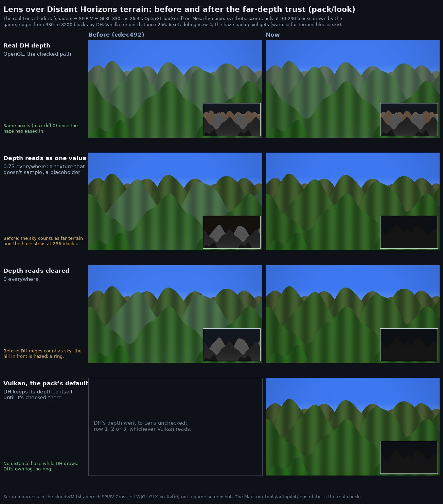

# pack/look: hand-off (cloud session, 2026-10-24)

Branch `pack/look`, merged with `origin/build/awaken-v1` (2e05a76). Not merged into build/awaken-v1: the main session
does that.

## Done
- **Lens never hazes by a far depth it can't trust** (SPEC §14, "Lens and far terrain"). A shared far depth must prove
  itself first: a new one-pixel pass, `lens_far_probe`, samples it at 8×6 points and trusts it once two of the points
  where far terrain drew differ. A persistent 1×1 target, `awaken:lens_far_trust`, latches that answer. A depth that
  reads as one value everywhere never proves itself. Until a depth is trusted, Lens adds no distance haze while DH
  draws, and far terrain counts as sky for bloom and shafts. Once proven, the haze eases in over 32 frames. The far
  terrain rules now live once, in `shaders/include/lens_far.glsl`, shared by the probe, the prefilter and the
  composite.
- **DH on Vulkan keeps its depth to itself.** `DistantHorizonsClient` shares DH's depth only on `CHECKED_ON` (OpenGL),
  logs once on any other API, and the fallback above takes over: never a ring, never a wrong haze. The real-depth path
  on OpenGL is unchanged: on real depth the old and new shaders give the same pixels (max difference 0) once the haze
  has eased in.
- **Finding: the "constant on Vulkan" was Lens's own placeholder.** The Vulkan check ran on ce91c76, before e719e4d
  taught `FarTerrain` to unpack DH's `Object[]`. So Lens sampled its own 1×1 placeholder, created without data (0 on
  OpenGL, leftover memory on Vulkan), not DH's depth. DH's real depth on Vulkan is untested, not known broken. A note is
  added to docs/perf/vulkan/REPORT.md.
- **Dev switch for that check:** the autopilot line `fardepth share|auto` makes DH share its depth on every graphics
  API (through `CompatClient.shareFarDepthEverywhere`). tools/autopilot/lens-dh.txt now ends with shots 14 to 16 that
  use it.
- **`FarTerrain` stays generic**: a depth texture, its clip planes and convention, and the frame it drew. It holds no
  companion types and no backend rule. Awaken's own far terrain can report the same way and prove itself the same way.
- **Ultra's disabled reason** says Iris needs OpenGL, names the API the game runs on, and gives Iris's Sodium pin
  ("Iris 1.11.7 pins Sodium 0.9.2, which crashes on this NeoForge: Ultra waits for an Iris update"). With a newer Iris on
  Vulkan it says where to switch: Video Settings → Graphics API, then restart. Every reason is at most 180 characters,
  so it fits the Look screen's three note lines; `compat_look_ultra_gate` checks this.
- SPEC §14 is updated: the Lens passes, the Vulkan bullet, Lens and far terrain, debug view 3's colours, and the Ultra
  reason.

## Checked in the cloud VM (no game client, per the cloud rules)
- `./gradlew build`: passes.
- `runGameTestServer`: all 328 tests pass, both on the merge alone and with the change. The first run with the change
  had 2 timing failures outside this diff, `anomaly_grove_bends_the_rules` (a known anomaly platform-wait flake) and
  `powers_hits_ground_slam_lineup` ("ravager did not move"). The re-run passed all 328.
- Shaders: every `assets/awaken/shaders/post/*.fsh` compiles the way 26.3 compiles it (shaderc to SPIR-V for Vulkan
  1.2, includes resolved) and cross-compiles to GLSL 330 (the OpenGL backend) and MSL (MoltenVK). A deliberately broken
  copy fails, as a control.
- Both Lens chains parse with the game's own `PostChainConfig.CODEC`. Their only external target is `minecraft:main`,
  and `lens_far_trust` is persistent.
- The real Lens shaders ran on Mesa llvmpipe, in GLSL cross-compiled exactly as above, over a synthetic DH scene (sheet
  below). A real depth proves itself on the first frame and eases in over 32 frames. A constant depth (0.73) and a
  cleared one (0) never prove themselves. Before this change, those two gave a wrong haze on the sky and a ring at
  256 blocks.

## Left for the Mac (tours)
1. `tools/autopilot.sh tools/autopilot/lens-dh.txt` with `PACK=perf,horizon DH=swift`, on Vulkan (the default):
   - Shots 2 to 13: no distance haze while DH draws, and view 4 flat (no ring).
   - Shots 14 to 16 (`fardepth share`), in view 3: bands with blue 1 mean DH's depth works on Vulkan. Then add Vulkan
     to `DistantHorizonsClient.CHECKED_ON` (and SPEC §14). Blue 0.6 means it reads as one value, so keep the rule.
   - Check the log for `[compat] Distant Horizons on Vulkan: its depth isn't checked there`.
2. The same tour with `BACKEND=opengl`: as on 2026-10-24 (real depth, haze across the vanilla edge, no ring), with the
   haze easing in once DH's terrain is first in view.
3. `tools/autopilot/look.txt`: hover Ultra on Vulkan. The amber reason should show in at most three lines.
4. Cost: the two one-pixel passes, plus one texel fetch per pixel in the prefilter and composite. It should not show
   in `perf-pack.txt`; worth one A/B against the previous build if the Swift budget is tight.

## Notes for the next cloud session
- Maven Central rate-limits this VM (HTTP 429). A local Gradle init script, not committed, puts Google's mirror first:
  `~/.gradle/init.d/central-mirror.gradle` with `https://maven-central.storage-download.googleapis.com/maven2/`.
- Sources: after a build, the patched Minecraft sources are in
  `~/.gradle/caches/neoformruntime/intermediate_results/transformSources_*_output.zip`.
- The VM has Mesa llvmpipe and Xvfb. A shader check (shaderc and SPIRV-Cross from the Gradle cache's LWJGL) could become
  a CI step that catches post-shader errors before the Mac does. Not added: it's outside this task.

## CI
- GameTests run 40101519000 on 60a2ee0 (the code): success, first attempt
  (https://github.com/euansprr-dev/awaken/actions/runs/40101519000). This hand-off commit gets its own run.
