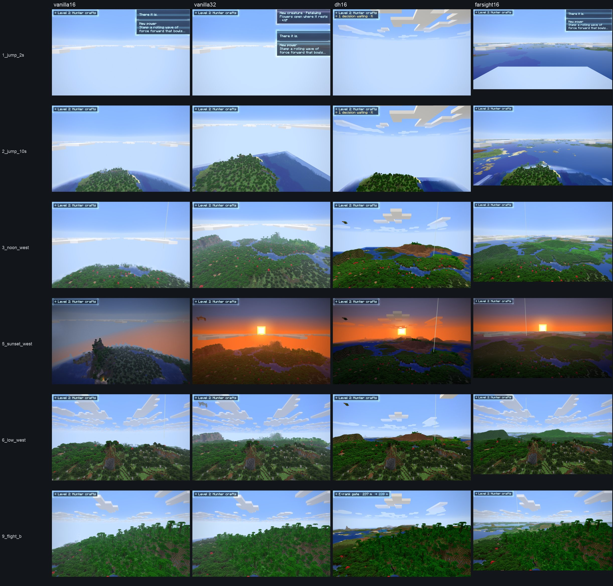

# Far Sight, stage 0: the decisive A/B

2026-10-24, MacBook Pro M4, the MacBook's own framebuffer (2880×1800, a 1440×900-point window), Vulkan (MoltenVK
1.4.2), Lens Swift, `PACK=perf` for every run. Same seed (777), places, times and weather for every setup:
`tools/autopilot/farsight-ab.txt`, run per setup by `tools/farsight-ab.sh`. Far Sight was measured from a checkout
pinned at the stage 0 commit, `36f28c2`.

| Setup | What it shows |
|---|---|
| vanilla16 | render distance 16 (256 m), nothing beyond |
| vanilla32 | render distance 32 (512 m) |
| dh16 | render distance 16 + Distant Horizons 3.3.4, Swift preset (128 chunks, about 2 km) |
| farsight16 | render distance 16 + Far Sight, 7 rings out to about 16 km |

## Verdict

| Gate | Result |
|---|---|
| At RD 16 with rings to 8–16 km, costs no more than vanilla RD 32 | **Pass.** Cheaper than vanilla RD 32 in all five scenes (p50 −0.4 to −3.9 ms), drawing 32× farther |
| The horizon appears within 2 s | **Pass.** The whole horizon (ring 6, 128-block cells to 16 km) is ready 0.4–0.8 s after the first frame. Rings 3–6 (16-block cells and coarser) are complete after 1.5–2.2 s. 2 s after a 30 km jump, the horizon is drawn and the real chunks have not loaded (shot 1_jump_2s) |
| Looks at least as good | **Mixed.** Far Sight is the only setup with a horizon: land and sea to 16 km, hazed by Lens. But where DH has real chunks (to 2 km) it shows more: real trees, cliff sides in dirt and stone. Far Sight shows predicted ground (no trees yet), and every wall takes its top's colour. Details and the fixes below |
| No seams in a flight | **Pass.** No crack or step between rings, or between rings and real chunks, in any flight shot (8, 9, 10) or the look tour |
| OpenGL works | **Pass.** OpenGL 4.1 (Metal): the shaders compile, the horizon is ready in 1.8 s, and Lens reads Far Sight's depth |

## Frame time (ms: p50 / p95 / p99)

| Scene | vanilla16 | vanilla32 | dh16 | **farsight16** |
|---|---|---|---|---|
| vista, noon, west | 8.33 / 11.68 / 14.07 | 13.17 / 17.86 / 49.02 | 10.18 / 11.64 / 13.37 | **10.73** / 20.13 / 44.48 |
| vista, noon, east | 8.34 / 10.67 / 13.67 | 8.75 / 11.01 / 13.05 | 8.50 / 9.83 / 11.34 | **8.30** / 10.13 / 13.15 |
| vista, sunset, west | 8.28 / 9.59 / 13.33 | 13.06 / 14.81 / 16.07 | 10.98 / 12.26 / 13.25 | **9.11** / 10.87 / 12.10 |
| low over the land | 8.26 / 9.62 / 10.07 | 11.76 / 13.24 / 13.72 | 11.47 / 12.82 / 13.75 | **9.17** / 10.64 / 11.34 |
| flight, 20 blocks/s | 8.29 / 10.23 / 15.55 | 11.97 / 18.91 / 36.87 | 12.18 / 15.40 / 21.29 | **10.93** / 14.32 / 19.48 |

- vanilla16 sits at 8.3 ms everywhere: the 120 Hz display cap on Vulkan (MoltenVK presents in FIFO). Its true cost
  is lower and unmeasured, so Far Sight's own cost shows only where it rises above the cap. That is about 0.8–0.9 ms
  at sunset and low over the land, and 2.6 ms in flight, when its workers re-predict the exact rings on the CPU
  beside the server's own chunk generation.
- Far Sight's first scene (noon, west) ran while its exact rings were still being predicted (about 400 µs per
  column on three worker threads): its p95/p99 there is that work. Once filled (noon, east), it sits at the cap.
- Far Sight's own render-thread time is 0.2–0.4 ms a frame (plan, uploads, bake, draw). Its draw is about 42 pieces
  and 172,000 cells. GPU timestamps read zero on MoltenVK, so its GPU time is known only from the frame times above.
- Memory: Far Sight holds 23 MB of GPU memory (five 256×1792 RGBA8 atlases and its own depth at framebuffer size)
  and almost no heap. Heap at each scene (one sample, GC-dependent): Far Sight 0.95–1.2 GB, DH 1.0–1.9 GB,
  vanilla RD 16 1.0–1.9 GB, vanilla RD 32 1.7–3.3 GB.
- The OpenGL run (`farsight-gl`) was 8.1–10.6 ms, but its window came up 2880×1658, so it isn't comparable. It only
  confirms Far Sight works there.

Raw lines: `vanilla16.txt`, `vanilla32.txt`, `dh16.txt`, `farsight16.txt`, `farsight-gl.txt` (perf, info, Far Sight
status per scene).

## Time to the horizon

| Run | Ring 6 (the whole horizon) | Rings 3–6 | Rings 0–2 (exact heights) |
|---|---|---|---|
| look tour, at join | 0.41 s | 1.48 s | 18.5 s |
| A/B, at join | 0.54 s | 2.15 s | — |
| A/B, after a 30 km jump | 0.79 s | 2.22 s | — |
| OpenGL, at join | — | 1.83 s | — |

The horizon appears coarse first and sharpens. Until a finer ring arrives, the coarser one shows in its place, so
there is never a hole. Exact heights within a kilometre cost about 400 µs a column (`getBaseHeight` runs the whole
noise column), so rings 0–2 take seconds. The surface estimate farther out costs 17–29 µs.

## Side by side

Rows: 2 s and 10 s after a 30 km jump; noon looking west; sunset looking west; low over the land; mid-flight.

- **Jump:** at 2 s only Far Sight shows anything below the horizon. At 10 s vanilla and DH show the island, and
  Far Sight shows the island plus the sea and islands to the horizon.
- **Noon, west:** DH's 2 km of real terrain has more in it: trees, and a hill whose sides are dirt and stone. Far
  Sight has the same hill as green terraces, then land and sea to 16 km where DH's world ends in fog.
- **Sunset and low:** Far Sight's far land takes the sunset light and Lens's haze. Vanilla RD 32 shows half a
  kilometre more of real terrain at 3–4 ms more cost.

## Where the look falls short, and what closes it

Euan's reference shots (block-level far terrain to the horizon: tree canopies, banded cliffs, crisp terrace edges,
haze) set the bar. Each ring cell covers about 18–37 pixels on screen at every distance, and predicted ground has no
trees. Fixes, cheapest first:
1. Shading on the rings: cliff walls in dirt and stone (banded strata in badlands), crisp terrace edges, per-block
   colour texture on tops, and procedural tree canopies in predicted forests (replaced by the real ones where seen).
2. The generated layer (stage 1, built): real chunks win over the prediction at 2-block resolution, cached on disk.
   Explored land shows its real canopies, rivers and builds.
3. A real-detail near tier: real chunks generated in the background at low priority (as DH does), feeding finer
   cells for the first kilometres. This is the plan's voxel tier, best on Turbo compute.
